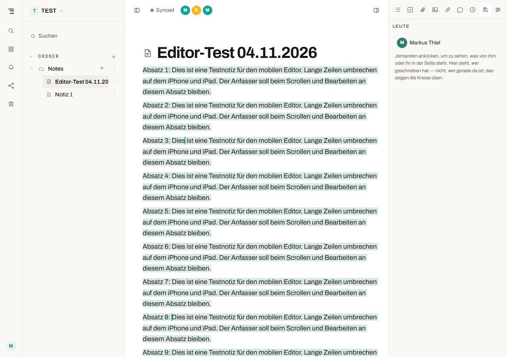
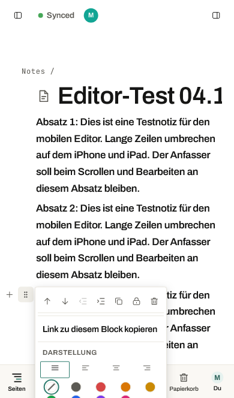

# SONE Editorprüfung und Verbesserungskatalog

**Nachtrag zur Umsetzung:** Die offenen Codebefunde E02–E06 wurden nach dieser
Prüfung korrigiert; E01 war bereits im Ausgangsstand behoben. Details stehen in
[ADR-0204](../adr/0204-editor-menues-und-linkziele.md). 337 Editor-Tests,
1.212 Webtests und Browserregressionen in Chromium und WebKit bestanden.
Der folgende Katalog dokumentiert den ursprünglichen Prüfstand einschließlich
seiner Messwerte. Die Abnahme auf physischen iOS-Geräten bleibt offen.

Stand: 4. November 2026. Geprüftes Repo: `76c26d4`, Version `0.14.13-dev`.
Demo-Bundle: `index-Boi8C1Nk.js` mit zugehöriger Source Map.

Die wichtigsten offenen Probleme liegen in der Positionierung der mobilen
Bedienelemente und im Linkfilter. Die gemeldete vollständige Textfärbung ist in
der Demo reproduzierbar, im aktuellen Repo aber bereits durch ADR-0203
korrigiert. Diese beiden Versionsstände dürfen bei der Fehlerbehebung nicht
verwechselt werden.

## Umfang und Aussagekraft

Live-Prüfung mit angemeldetem Mitglied und separater Gastsitzung; Chromium auf
Desktop sowie Playwright-WebKit mit Touch-Emulation in iPhone- und iPad-Größen:
390 × 664, 810 × 1080 und 1080 × 810 CSS-Pixel. Dafür wurde ausschließlich die
neue Seite **Editor-Test 04.11.2026** im Demo-Ordner Notes bearbeitet.

Das sind Browserprüfungen, keine Tests auf einem physischen iPhone oder iPad.
Insbesondere echte iOS-Bildschirmtastatur, Safari-Browserleisten, Pinch-Zoom,
Autokorrektur und native Auswahlgriffe sind damit noch nicht abgenommen.
Die ursprüngliche, umfassende Backend- und Berechtigungsprüfung ist nicht
Gegenstand dieses auf den Editor konzentrierten Katalogs.

## Prioritäten

P1 bedeutet zeitnah vor breiterer Nutzung beheben bzw. ausrollen; P2 bedeutet
planmäßige Verbesserung. Die Priorität ist eine Arbeitsreihenfolge, keine
CVSS-Bewertung.

| ID | Priorität | Befund | Status |
| --- | --- | --- | --- |
| E01 | P1 | Autorenfarbe bleibt ohne sichtbaren Auswahlzustand stehen | Demo bestätigt; Korrektur im Repo vorhanden |
| E02 | P1 | Blockmenü läuft auf iPhone und iPad unten aus dem Bildschirm | Live bestätigt; im Repo offen |
| E03 | P1 | Linkfilter akzeptiert verschleierte ausführbare URL-Schemata | Speicherung und Übertragung bestätigt; Skriptausführung nicht nachgewiesen |
| E04 | P2 | Formatierungsleiste verschwindet bei großer Auswahl außerhalb des Bildschirms | Live bestätigt; im Repo offen |
| E05 | P2 | Anfasser eines noch sichtbaren Absatzes kann bereits außerhalb des Bildschirms liegen | Bedienproblem bestätigt; kein zufälliger Höhenversatz nachgewiesen |
| E06 | P2 | Plus und Blockmenü haben nur 26 × 26 Pixel große Touchflächen | Live gemessen; im Repo offen |

## E01 Autorenfarbe bleibt nach Reiterwechsel stehen

**Nachstellen in der geprüften Demo:** Seite mit Text einer Person öffnen →
rechte Seitenleiste → Leute → Person anklicken → Gliederung → zurück zu Leute.

Die Textmarkierungen bleiben erhalten, während der Personenknopf
`aria-pressed=false` meldet und der Hilfetext zum Auswählen einer Person
auffordert. Im Test blieben 15 `.sone-authored`-Elemente vor und nach dem
Reiterwechsel bestehen. Der erste erneute Klick markiert dieselbe Person
nochmals; erst der zweite hebt die Markierung auf.



**Ursache in der Demo:** Die Auswahl liegt im lokalen Zustand von
`Contributors`, die Dekoration im Editor. Der Reiterwechsel hängt die
Komponente aus, ohne die Dekoration zu löschen.

**Aktueller Repo-Status:** Bereits durch [ADR-0203](../adr/0203-die-hervorhebung-lebt-neben-ihrem-schalter.md)
adressiert: Die Auswahl liegt nun in
[`authorHighlightBridge.ts`](../../packages/web/src/components/authorHighlightBridge.ts),
[`Contributors.tsx`](../../packages/web/src/components/Contributors.tsx) liest
sie mit `useSyncExternalStore`. Das Schließen der Seitenleiste löscht sie.
Die zugehörigen vorhandenen Tests bestanden in dieser Prüfung.

**Nächste Maßnahme:** Diesen Stand ausrollen, anschließend die Browser neu
laden und den Ablauf auf der ausgelieferten Version erneut prüfen. Der Test
weist nach, dass die geprüfte Demo noch die alte Implementierung enthält;
eine Deployment-Änderung wurde im Rahmen dieser Prüfung nicht vorgenommen.

**Abnahme:** Nach Reiterwechsel stimmt die angezeigte Auswahl mit der Farbe
überein; ein Klick deaktiviert sie. Schließen der Seitenleiste und Wechseln
der Seite entfernen die Markierung. Eine neue Sync-Benachrichtigung darf sie
nicht ungewollt löschen.

## E02 Blockmenü wird am unteren Rand abgeschnitten

**Nachstellen:** Längeren Text mit umbrochenen Absätzen öffnen, einen Absatz
nahe dem unteren Bildschirmrand antippen und dessen Blockmenü öffnen.

| Ansicht | Menü oben | Menü unten | Bildschirmhöhe |
| --- | ---: | ---: | ---: |
| iPhone | 478,39 px | 943,19 px | 664 px |
| iPad | 968,83 px | 1554,08 px | 1080 px |

Ein erheblicher Teil des Menüs liegt außerhalb des sichtbaren Bereichs.
Die vorhandene interne Scrollfläche verhindert das nicht: Der Menürahmen
selbst wird außerhalb des Bildschirms platziert.



**Fundstellen:**
[`BlockMenu.tsx`](../../packages/web/src/components/BlockMenu.tsx), insbesondere
Zeilen 756–760 und 929–936; [`styles.css`](../../packages/web/src/styles.css),
ab Zeile 5086. `top: anchor.top` wird direkt übernommen; `70vh` begrenzt nur
die Höhe, nicht den unteren Rand. Diese Implementierung ist zwischen Repo
und Demo identisch.

**Verbesserung:** Menü nach dem Messen bei Bedarf nach oben öffnen und seine
Position sowie maximale Höhe auf den tatsächlich sichtbaren Bereich
begrenzen. Dabei obere Leiste, untere Navigation und die Bildschirmtastatur
berücksichtigen. Für kleine Touchgeräte ist ein unten eingeblendetes
Blockaktionsmenü mit eigener Scrollfläche eine sinnvolle Alternative.

**Abnahme:** Bei erstem, mittlerem und letztem sichtbarem Absatz sind sämtliche
Aktionen durch Scrollen innerhalb des sichtbaren Menüs erreichbar. Zusätzlich
mit geöffneter Tastatur, gedrehtem Gerät und größerer Schrift prüfen.

## E03 Linkfilter lässt Steuerzeichen im Schema passieren

**Fundstelle:** [`hrefs.ts`](../../packages/editor/src/hrefs.ts), Zeilen 44–51.
`isFollowable` prüft das Schema per regulärem Ausdruck. Ein Tabulator oder
Zeilenumbruch im Schema verhindert den Treffer; die Funktion erlaubt die URL
dann über `if (!match) return true`.

| Eingabe in JavaScript-Schreibweise | `isFollowable` | Browser-Protokoll |
| --- | --- | --- |
| `javascript:void(0)` | false | `javascript:` |
| `java\tscript:void(0)` | true | `javascript:` |
| `java\nscript:void(0)` | true | `javascript:` |
| `java\rscript:void(0)` | true | `javascript:` |

**Live-Nachweis:** Über den Paste-Handler wurde in der eigenen Testseite als
Gast ein HTML-Link mit `java&#9;script:` eingefügt. Im Gast- und Mitgliedereditor
erschien anschließend derselbe Link mit einem echten Tabulator im gespeicherten
`href`; die DOM-Eigenschaft `protocol` war `javascript:`. Es wurde nur ein
harmloser Testmarker verwendet, ohne Zugriff auf Daten oder Übertragung an
andere Dienste. Der Testlink wurde anschließend per Undo entfernt und sein
Fehlen nach Neuladen bestätigt.

**Reichweite:** Die Umgehung des Filters und die Übertragung des problematischen
Links an einen anderen Benutzer sind bestätigt. Eine erfolgreiche
Skriptausführung durch normale Bedienung ist **nicht** bestätigt: React ersetzte
das Ziel der normalen „Öffnen“-Schaltfläche durch seine Sicherheitsblockade.
Deshalb ist dies ein bestätigter Validierungsfehler mit Sicherheitsrelevanz,
kein behaupteter vollständiger Stored-XSS-Nachweis.

Betroffen sind auch die Aufrufer in
[`schema.ts`](../../packages/editor/src/schema.ts) beim HTML-Import und
[`links.ts`](../../packages/editor/src/links.ts) beim Öffnen. Das reguläre
Ausdrucksmuster stimmt zwischen Demo und Repo überein.

**Verbesserung:** Das vom URL-Parser interpretierte Protokoll gegen die
zulässigen Schemata prüfen; relative Links gezielt erhalten. Dieselbe Regel
für Einfügen, Laden bestehender Dokumente, Rendern und Öffnen verwenden.
Bereits gespeicherte problematische Linkziele dürfen nicht als aktive Links
ausgegeben werden. Der Browser entfernt ASCII-Tabulatoren und Zeilenumbrüche
bei der URL-Verarbeitung; genau diese Abweichung zur Regex ist zu berücksichtigen.
Siehe [WHATWG URL Standard, Basic URL Parser](https://url.spec.whatwg.org/#concept-basic-url-parser).

**Abnahme:** Tests für Tabulator, LF und CR, Groß-/Kleinschreibung und
HTML-Zeichenreferenzen durch den echten Schema-Parser. Der Linktext bleibt
erhalten, aber es entsteht kein Link-Mark mit ausführbarem Protokoll.
Normale HTTPS-, relative, Mailto- und Tel-Links bleiben benutzbar. Zusätzlich
ein altes gespeichertes Dokument mit solchem Link sicher anzeigen.

## E04 Formatierungsleiste liegt bei großer Auswahl außerhalb des Bildschirms

**Nachstellen:** Lange Seite öffnen, nach unten scrollen und Text über den
sichtbaren Ausschnitt hinaus auswählen. Im Browser wurde die Auswahl über
die native Selection-API über den Editorinhalt gespannt; die tatsächlichen
iOS-Auswahlgriffe wurden damit nicht getestet.

In der iPhone-Ansicht lag die Formatierungsleiste bei **y = 1712,42 bis
1756,42 px**, bei nur **664 px** Bildschirmhöhe. Die Auswahl existierte, die
Aktionen waren unsichtbar.

**Fundstelle:**
[`SelectionToolbar.tsx`](../../packages/web/src/components/SelectionToolbar.tsx),
Zeilen 137–151. Die Logik platziert die Leiste entweder oberhalb des
Auswahlanfangs oder unterhalb des Auswahlendes. Wenn beide außerhalb des
Bildschirms liegen, gibt es keinen sichtbaren Ersatzanker und keine vertikale
Begrenzung. Repo und Demo sind hier identisch.

**Verbesserung:** Sichtbare Auswahlrechtecke bestimmen und eine erreichbare
Position innerhalb des sichtbaren Editorbereichs wählen. Bei einer
bildschirmübergreifenden Auswahl eine feste Formatierungsleiste erwägen.
Dieselbe Platzierungsfunktion für Block-, Formatierungs- und Slashmenü nutzen.

**Abnahme:** Vorwärts- und Rückwärtsauswahl, „Alles auswählen“, anschließend
Scrollen, Seitenleiste öffnen und Tastatur ein-/ausblenden. Die Leiste bleibt
bedienbar, ohne die Auswahl zu verändern.

## E05 Der Anfasser folgt dem Absatzanfang und kann unsichtbar werden

**Messung:** Vor dem Scrollen lagen Absatz und Anfasser exakt bei
`y = 478,39 px`. Nach 530 px Scrollen lagen beide exakt bei `y = −51,61 px`.
Der Absatz reichte dabei noch bis `y = 86,91 px`, der Anfasser nur bis
`y = −25,61 px`: Text war noch sichtbar, seine Aktion aber nicht mehr.
Auch nach Wechsel auf 1080 × 810 lagen Anfasser und Absatz auf derselben
gemessenen Höhe (`418,97 px`).

Das bestätigt ein Bedienproblem bei umbrochenen Absätzen, **nicht** einen
zufälligen Versatz beim normalen Scrollen. Der Anfasser gehört zum gesamten
Block, nicht zu jeder sichtbaren Textzeile. Die konkrete Meldung „auf falscher
Höhe“ bei echter iOS-Tastatur bleibt zusätzlich zu untersuchen.

**Fundstelle:**
[`BlockMenu.tsx`](../../packages/web/src/components/BlockMenu.tsx), Zeile 757:
`top: box.top`. Der vorhandene
[`useViewportChanges.ts`](../../packages/web/src/hooks/useViewportChanges.ts)
beobachtet bereits Scrollen, Größenänderungen und VisualViewport-Ereignisse.
Ein weiterer bloßer Scroll-Listener wäre daher keine angemessene Reparatur.

**Verbesserung:** Für Touchgeräte Aktionen am sichtbaren Teil des aktiven
Blocks oder in einer dauerhaft erreichbaren Blockleiste anbieten. Einen
außerhalb des sichtbaren Bereichs liegenden Block nicht durch einen frei
schwebenden, einem anderen Absatz zugeordnet wirkenden Anfasser darstellen.

**Abnahme:** Absatz länger als der Bildschirm, große Schrift, Listen,
Tabellen und Bilder. Der aktive Block bleibt eindeutig; seine Aktionen
sind erreichbar, solange darin gearbeitet wird.

## E06 Touchflächen der Blockaktionen sind kleiner als vorgesehen

Plus und Blockmenü waren jeweils **26 × 26 CSS-Pixel** groß. Beide hatten
weder `::before`- noch `::after`-Flächen. Ein Hit-Test 5 px ober- und unterhalb
des Buttons traf keinen der Buttons.

**Fundstelle:** [`styles.css`](../../packages/web/src/styles.css), ab Zeile
5031. Der Kommentar verspricht eine über die Box hinaus vergrößerte
Trefferfläche; im geprüften Layout war diese nicht vorhanden.

**Verbesserung:** Für Touch tatsächlich ausreichend große, voneinander
getrennte Trefferflächen vorsehen, beispielsweise 44 × 44 px entsprechend
dem im Repo verwendeten Touchmaß. Die Gutterbreite von 54 px reicht für zwei
solche nebeneinanderliegenden Ziele nicht aus. Deshalb das mobile Layout
anpassen, statt unsichtbare, sich überlappende Flächen über den Text zu legen.

**Abnahme:** Beide Aktionen mit dem Finger getrennt treffen; keine versehentliche
Textauswahl oder Auslösung der Nachbaraktion. Per Hit-Test auch die Ränder
der vorgesehenen Trefferfläche kontrollieren.

## Weitere Prüfungen und Verbesserungen

1. **Echte iOS-Tastatur als nächster Pflichtdurchlauf:** Schreiben am unteren
   Rand, Auswahlgriffe ziehen, Tastatur öffnen/schließen, Hoch-/Querformat,
   Safari und installierte Web-App. Die Menülogik muss den sichtbaren
   Ausschnitt berücksichtigen: `SlashMenu.tsx:146` verwendet beispielsweise
   weiterhin `window.innerHeight`, obwohl VisualViewport-Ereignisse bereits
   beobachtet werden. Das ist ein begründeter Prüfpunkt, kein hier live
   nachgestellter Tastaturfehler. Die sichtbaren Maße und Versätze liefert
   [VisualViewport](https://developer.mozilla.org/en-US/docs/Web/API/VisualViewport).
2. **Eigene Sitzungen und andere Personen unterscheidbar machen:** Der
   Yjs-Cursorfilter unterscheidet Client-IDs, nicht Benutzeridentitäten. Ein
   weiterer eigener Tab oder ein iPad erscheint deshalb als weitere Sitzung
   mit eigener Auswahl. Im Test waren mehrere Cursors desselben Mitglieds
   sichtbar. Sitzungen eindeutig beschriften oder eigene Auswahlhervorhebung
   entsprechend gestalten; Gastnamen nicht als verifizierte Identität behandeln.
3. **Farbbedeutungen verständlich halten:** Autorenmarkierung und aktuelle
   Auswahl eines Mitarbeitenden sind verschiedene Funktionen. Beim Gast
   färbte „Alles auswählen“ fast den ganzen Text im Mitgliedereditor; nach
   Aufheben der Auswahl war die Remote-Farbe wieder vollständig weg. Das
   war im Test korrektes Verhalten. Einen aktiven Autorenmodus sichtbar
   benennen und einfach beenden können.
4. **Browser-Geometrietests ergänzen:** Für Menüs nicht nur Vorhandensein,
   CSS-Text oder Eventhandler prüfen, sondern tatsächliche Rechtecke nach
   Scrollen, Auswahl, Resize und Seitenleistenwechsel. Die vorhandenen
   jsdom-Tests können die hier gemessene Positionierung nicht abnehmen.
5. **Release-Abgleich verbessern:** Commit oder Build-ID in einer
   Diagnoseansicht anzeigen. Das verhindert, dass bereits behobene Fehler
   gegen einen älteren Demo-Build erneut bearbeitet werden.

## Ausgeführte Prüfungen

| Prüfung | Ergebnis |
| --- | --- |
| Compile von core, client und editor mit `tsc -b` | Bestanden |
| Editor: hrefs, links und mount | 34 Tests bestanden |
| Web: peoplePanel, contributors, viewportChanges und editorSurface | 38 Tests bestanden |
| Drei zusätzliche URL-Varianten mit Tab/LF/CR gegen aktuellen Quellcode | Alle drei passieren den Filter fehlerhaft |
| Gast fügt HTML-Testlink ein; Mitglied empfängt ihn | Bestätigt |
| Testlink per Undo entfernen und nach Neuladen prüfen | Entfernt |
| Gast schreibt regulär; Mitglied und WebKit empfangen Text | Bestanden |
| Neuladen und Gasttext erneut lesen | Bestanden; 14 ursprüngliche Testabsätze erhalten |
| Normales Scrollen und Wechsel auf iPad-Querformat | Kein bleibender Höhenversatz gemessen |
| Gast hebt vollständige Auswahl auf | Remote-Hintergrund verschwindet |

Die Testauswahl umfasst 72 bestehende Tests, nicht die vollständige Suite.
Bei den Webtests erschienen außerdem React-`act(...)`-Warnungen und eine
TextSelection-Warnung; es gab keine fehlgeschlagenen Assertions. Die Tests
wurden mit der im Projekt festgelegten pnpm-Version 9.15.0 installiert.

Der Browsermitschnitt enthält außerdem zwei WebKit-Meldungen zu Access-Control-
Prüfungen beim Laden der Seitenliste. Deren Ursache wurde nicht isoliert;
sie werden deshalb nicht als bestätigter Berechtigungsfehler gezählt. Beim
Gerätetest auch Netzwerkanfragen während Neuladen und Wiederverbinden prüfen.

Reproduzierbare lokale Befehle, jeweils vom Repo aus:

```powershell
node packages/web/node_modules/typescript/bin/tsc -b packages/core packages/client packages/editor

# Aus packages/editor:
node --import ../../node_modules/tsx/dist/loader.mjs --test test/hrefs.test.ts test/links.test.ts test/mount.test.ts

# Aus packages/web:
node --import ../../node_modules/tsx/dist/loader.mjs --test test/peoplePanel.test.tsx test/contributors.test.ts test/viewportChanges.test.tsx test/editorSurface.test.tsx
```

Die Browsermesswerte liegen in
[`measurements.json`](editor-2026-11-04/measurements.json), weitere Bilder im
gleichen Verzeichnis. Keine Zugangsdaten oder Gastlink-Token sind enthalten.
Die Testseite bleibt zur Nachprüfung in der Demo bestehen. Anwendungscode
und Deployment wurden für diese Prüfung nicht verändert.

## Empfohlene Reihenfolge

1. Bereits vorhandene Korrektur der Autorenfarbe ausrollen und gegen die
   tatsächlich geladene Version prüfen.
2. Linkfilter schließen und Tests durch echten HTML-Import sowie für
   bestehende Dokumente ergänzen.
3. Gemeinsame Platzierungslogik für Editor-Menüs umsetzen; die Messfälle
   E02 und E04 als Browserregressionen übernehmen.
4. Mobile Blockaktionen mit größeren Trefferflächen und klarer Zuordnung
   zum sichtbaren Block überarbeiten.
5. Die Kombination auf echten iPhones und iPads mit Bildschirmtastatur
   abnehmen, einschließlich Gast und zwei eigenen Sitzungen.
